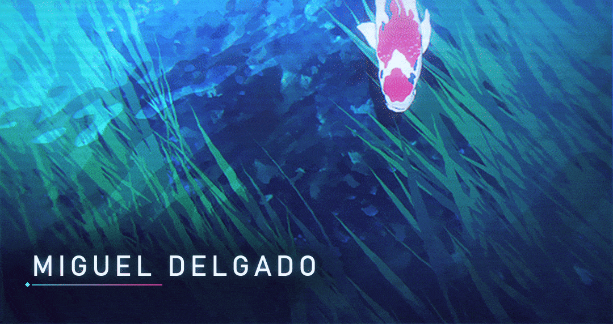

  

<h1 align="center">Hi, I'm Miguel Delgado</h1>

  Computer Science Master's graduate · Database Administrator · Building full-stack, backend and mobile projects

  
  

---

## About me

I'm a Computer Science Master's graduate from **NOVA School of Science and Technology**, currently working as a **Database Administrator at NOS Portugal**.

Alongside my professional work, I'm building personal software projects focused on backend systems, full-stack platforms, mobile applications, and practical products with real-world use cases.

I'm especially interested in software engineering roles where I can combine product thinking, backend architecture, databases, APIs, and user-facing applications.

---

## Currently focused on

- Building full-stack and mobile portfolio projects with real-world use cases
- Improving backend architecture, API design, and clean project structure
- Working with PostgreSQL, FastAPI, React, TypeScript, Flutter, and Supabase
- Growing from database-focused work into broader software engineering
- Creating software that is useful, maintainable, and polished enough to demo

---

## Featured projects

### Estrela da Amadora Digital Platform

> Status: private for now — planned to be published soon.

A personal MVP/prototype for a football club digital ecosystem, built around the idea of connecting club staff, members, and fans through a modern digital platform.

The project includes:

- **FastAPI backend** with SQLAlchemy and PostgreSQL
- **Supabase** for database infrastructure
- **React + TypeScript backoffice** for staff workflows
- **Flutter mobile app** for fans and club members
- Features around matches, membership, tickets, quotas, and future payments

The goal is to build a realistic product-style platform, not just a small demo app.

> Independent portfolio project. Not officially affiliated with C.F. Estrela da Amadora.

---

### Wi-Fi Aware Mesh Overlay P2P Network

Master's thesis project developed in **Android/Kotlin**.

Designed and implemented a mesh overlay using Wi-Fi Aware, enabling direct and indirect peer-to-peer communication beyond a single cluster.

The project explored:

- Android Wi-Fi Aware / NAN
- Peer-to-peer communication
- Mesh overlay design
- Direct and indirect message routing
- Mobile networking constraints

---

## Tech I work with

### Languages

### Backend & databases

### Frontend & mobile

### Tools

---

## What I'm looking for

I'm interested in junior software engineering opportunities where I can work on:

- Backend systems
- Full-stack products
- Mobile applications
- Developer-focused tools
- Practical software with real users and real constraints

I value clean architecture, readable code, product thinking, and building things that people can actually use.

---

## GitHub activity

  

<!-- Optional: uncomment later if you want a second card.

  

-->

---

## Connect with me

- GitHub: [@PM-Delgado](https://github.com/PM-Delgado)
- LinkedIn: [Miguel Delgado](https://www.linkedin.com/in/YOUR-LINKEDIN-SLUG/)
